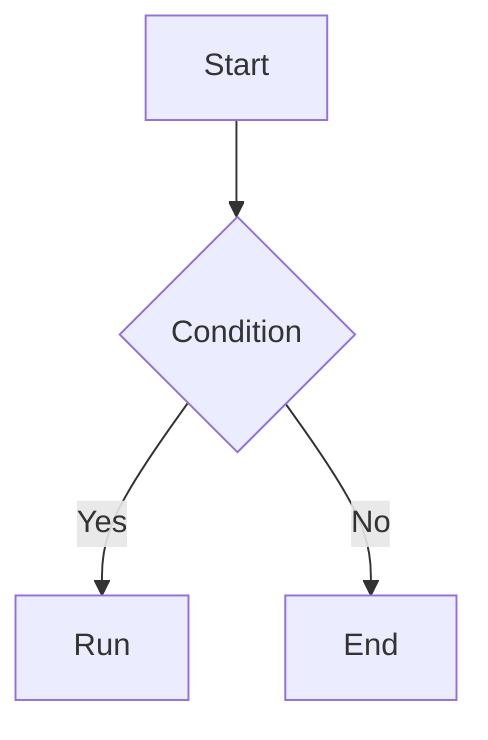

Writing tools look like a small detail, but you use them every day. Configure once, and you save a lot of repeated work later.

This is my Typora setup plus the Markdown patterns I use most. Theme taste is personal; pick what you like.

## Theme

I went through a few themes and settled on [Claude-Like Theme](https://theme.typora.io/theme/Claude-Theme/). The colors are soft, and code blocks, quotes, and tables look comfortable for long writing sessions.

Two other options:

- [LaTeX Typora](https://theme.typora.io/theme/LaTeX-Typora/): three-line tables and a more academic look, though I find the line spacing a bit wide.
- [Folio](https://theme.typora.io/theme/Folio/): reading-oriented and clean.

To install a theme:

1. Download and unzip the theme.
2. Copy everything except `README`.
3. Open Typora's Preferences → Appearance → Open Theme Folder.
4. Paste the files in and restart Typora.

If you don't like the styling, ask an AI to edit the CSS. A theme is just CSS; changing colors, font sizes, and spacing is not hard.


## Image paths

This is the easiest Typora trap to fall into, and the one I want to emphasize most.

There are two ways to reference an image in Markdown:

```markdown
<!-- Relative path -->


<!-- Absolute path -->

```

A relative path only cares where the image sits relative to the current document. Move the project folder, zip it, or send it to someone else, and the image still resolves.

An absolute path ties the image to one location on one machine. Move the folder to the desktop or switch computers, and the path breaks. Worse, once you have many images, you have no idea which path belongs to which image, so you end up fixing them one by one.


### Setup order

1. **Save the document first** so Typora knows which project folder it belongs to.
2. Open Preferences → Image.
3. Choose "Copy image to a specified path" and enter `./assets/`.
4. Make sure inserted images use relative paths.

Why save first? Typora needs the document's location to decide what `./assets/` is relative to. If you paste an image before saving, it may store the file in a default directory on the C drive and write an absolute path. Everything looks fine at the time, until you reinstall Windows or switch machines and the images disappear.

Saving has another benefit: Typora's recovery feature only starts tracking versions after the file has been saved. If the machine crashes, unsaved content may be lost; a saved document can often be recovered from history.


This principle is not limited to Typora. When writing code or config files, prefer relative paths for external files too. A project should be a folder you can move as a unit, not a pile of files pinned to absolute paths on one machine.

## Callouts

Typora supports GitHub-style callouts. Type `>` followed by a space, then `[!note]`, and you get a styled block:

```markdown
> [!note]
>
> This is a note.
```

Common types:

```markdown
> [!note]
> A general note

> [!tip]
> A tip

> [!important]
> Important information

> [!warning]
> A warning

> [!caution]
> Something to be careful about
```

Callouts are for things the reader should not miss but that don't belong in the main text. Don't make the whole article a callout; then nothing stands out.

This syntax mainly works in Typora and some GitHub-flavored Markdown renderers. When you export to HTML or publish elsewhere, the result may look different, so check before publishing.

## Editing shortcuts

- `Ctrl + Arrow`: move by word.
- `Shift + Arrow`: select by character.
- `Ctrl + Shift + Arrow`: select by word.
- `Ctrl + H`: find and replace.
- The left outline panel: useful for jumping around long documents.

Typora also has two focus modes:

- **Typewriter mode**: keeps the current line in the center of the screen.
- **Focus mode**: shows the current paragraph normally and dims the rest.

They can be combined. For long writing sessions, you don't have to hunt for the cursor, and earlier text is less distracting. It is easier to get into flow.

## Math compatibility

If you paste GPT-generated Markdown into Typora, formulas may not render.

The reason is that different tools use different LaTeX delimiters:

- Typora uses `$ ... $` and `$$ ... $$` by default.
- GPT-generated Markdown often uses `\[ ... \]` and `\( ... \)`.

The old workaround was find-and-replace: change `\[` to `$$` and `\]` to `$$`. That is easy to get wrong and annoying to repeat.

Newer Typora versions have a LaTeX Math Delimiter option under Preferences → Markdown. Enable it and Typora recognizes `\[ ... \]`. If the option is missing, update Typora first.

Different models also support Markdown to different degrees. Gemini has a "copy as Markdown" option, and pasting it into Typora usually keeps formatting and formulas intact. GPT's output may need a quick check.

## Markdown basics

These are the patterns I use most for blogs and notes. None of them are complicated, but they make documents clearer and easier for agents to read.

### Headings and table of contents

Use `#` through `######` for heading levels, and don't skip levels. For long documents, add `[TOC]` at the top and Typora generates a table of contents. The left outline panel also works for navigation.

```markdown
# Heading 1

## Heading 2

### Heading 3
```

Clear heading structure helps humans and helps an agent understand the document.

### Tables

```markdown
| Tool | Purpose | Recommendation |
| --- | --- | --- |
| Git | Version control | Required |
| Node.js | Run CLI tools | Required |
```

The pipe `|` separates columns. If a link label itself contains `|`, escape it as `\|`, or it will be parsed as a table column. This is a common trap in blog writing.

### Code blocks

Label the language when possible. Typora highlights it, and an agent can tell what kind of content it is:

````markdown
```python
print("hello")
```
````

### Task lists

```markdown
- [x] Done
- [ ] To do
```

Useful for plans and checklists.

### Footnotes

```markdown
This is a sentence[^1].

[^1]: This is the footnote.
```

Good for extra context without interrupting the main text.

### Mermaid diagrams

Typora supports Mermaid for flowcharts and sequence diagrams:

````markdown

````

Mermaid is enough for simple flows and architecture diagrams. It is clearer than a screenshot and easier to version.

### Links and images

```markdown
[link text](https://example.com)

```

Don't leave image alt text empty. Describe what the image shows. It helps accessibility and helps an agent understand the image.

### Front matter

If the document is going to a blog, add YAML front matter at the top:

```yaml
---
layout: post
title: "Post title"
date: 2026-05-18 12:00:00 +0800
categories: ["Tools & Resources"]
tags: ["Typora", "Markdown"]
description: "One-line description"
---
```

Field names and format should match the blog template, or Jekyll may not recognize them.

### HTML comments

When drafting, use HTML comments for notes to yourself or an agent. They don't render:

```markdown
<!-- TODO: add a screenshot here -->
```

## Markdown and agents

Markdown is no longer just for human readers. It is also input for agents.

Clear heading levels, labeled code blocks, and consistent link and image paths look like formatting details, but they affect how efficiently an agent can read and retrieve information. A messy note is tiring for a human and easier for a model to misread.

So my rules are:

- don't skip heading levels;
- label code block languages;
- use relative image paths and write alt text;
- add a table of contents or outline for long documents;
- keep key conclusions in their own paragraph instead of burying them in a long sentence.

Configure the tool until it stops interrupting your thinking. Spend the rest of your energy on the content.
