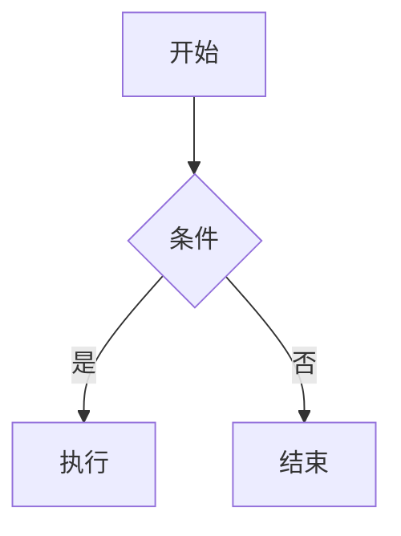

写作工具看起来是小事，但每天都要用。配置一次，后面能省很多重复操作。

这篇文章记录我的 Typora 配置，以及一些常用的 Markdown 技巧。主题审美因人而异，按自己的喜好来就好。

## 主题选择

我换过几个主题，最后留下的是 [Claude-Like Theme](https://theme.typora.io/theme/Claude-Theme/)。它的配色比较柔和，代码块、引用、表格的样式也舒服，长时间写作不刺眼。

另外两个可以参考：

- [LaTeX Typora](https://theme.typora.io/theme/LaTeX-Typora/)：表格是三线表，学术感更强，但我个人觉得行距偏宽；
- [Folio](https://theme.typora.io/theme/Folio/)：偏阅读向，排版干净。

安装方法：

1. 下载主题压缩包并解压；
2. 把除 `README` 以外的文件全部复制；
3. 打开 Typora 的“偏好设置 → 外观 → 打开主题文件夹”；
4. 把文件粘贴进去，重启 Typora。

如果对样式不满意，可以让 AI 帮你改 CSS。主题本质上是 CSS 文件，改颜色、字号、间距都不难。


## 图片路径

这是 Typora 最容易踩的坑，也是我最想强调的一条。

Markdown 里的图片有两种写法：

```markdown
<!-- 相对路径 -->


<!-- 绝对路径 -->

```

相对路径只关心“图片相对于当前文档在哪里”。整个项目文件夹一起移动、打包、发给别人，图片都不会丢。

绝对路径把图片绑定到了某台电脑的某个位置。你把文件夹移到桌面，或者换一台电脑，路径就失效了。更麻烦的是，图片多了以后，你根本不知道哪张图对应哪个路径，只能一张张改。


### 设置顺序

1. **先保存文档**，确定它所在的项目文件夹；
2. 打开“偏好设置 → 图像”；
3. 选择“复制图片到指定路径”，填入 `./assets/`；
4. 确认插入图片时使用的是相对路径。

为什么要先保存？因为 Typora 需要知道文档的位置，才能决定 `./assets/` 相对于哪里。如果先粘贴图片再保存，它可能把图片存到 C 盘的默认目录，并且写成绝对路径。当时看着正常，等重装系统或换电脑，图片就全挂了。

保存还有一个好处：Typora 的恢复功能只有在文件保存过之后才会开始记录版本。突然死机时，未保存的内容可能找不回来，保存过的文档还能从历史版本里恢复一些。


这条原则不只适用于 Typora。写代码、写配置文件时，引用外部文件也尽量用相对路径。项目应该是一个可以整体搬走的文件夹，而不是一堆绑定在本机绝对路径上的文件。

## Callout

Typora 支持 GitHub 风格的 callout。输入 `>` 加空格，再输入 `[!note]`，就会变成一个带样式的提示框：

```markdown
> [!note]
>
> 这是一条提示。
```

常用的类型有：

```markdown
> [!note]
> 普通提示

> [!tip]
> 小技巧

> [!important]
> 重要信息

> [!warning]
> 警告

> [!caution]
> 需要小心的地方
```

Callout 适合放“读的时候不想错过、但又不适合写进正文”的内容。不要整篇都是 callout，否则重点就不重点了。

需要注意的是，这种语法主要在 Typora 和部分支持 GitHub 风格 Markdown 的渲染器里生效。导出 HTML 或发布到其他平台时，效果可能不一样，发布前最好看一眼。

## 编辑技巧

- `Ctrl + 方向键`：按词移动光标；
- `Shift + 方向键`：按字符选中；
- `Ctrl + Shift + 方向键`：按词选中；
- `Ctrl + H`：查找和替换；
- 左侧大纲：长文跳转很方便。

Typora 还有两个提升专注度的模式：

- **打字机模式**：当前输入行始终保持在屏幕中央；
- **专注模式**：只有当前段落正常显示，其他内容变淡。

两个模式可以叠加。写长文时，视线不用来回找光标，也不容易被已经写过的内容干扰，比较容易进入心流。

## 公式兼容

如果你经常把 GPT 生成的 Markdown 粘贴到 Typora，可能会遇到公式不显示的问题。

原因是不同工具对 LaTeX 公式的界定符不一样：

- Typora 默认使用 `$ ... $` 和 `$$ ... $$`；
- GPT 生成的 Markdown 经常使用 `\[ ... \]` 和 `\( ... \)`。

以前的做法是查找替换，把 `\[` 换成 `$$`，把 `\]` 换成 `$$`。但这样容易误伤，也比较麻烦。

新版本的 Typora 在“偏好设置 → Markdown”里提供了 LaTeX Math Delimiter 选项，勾选之后就能识别 `\[ ... \]` 这种写法。如果你的 Typora 里没有这个选项，可以先更新版本。

另外，不同模型对 Markdown 的支持程度不一样。Gemini 有“复制 Markdown”的选项，粘贴到 Typora 里格式和公式通常比较正常；GPT 直接复制过去可能会有一些小问题，需要检查一遍。

## Markdown 常用语法

下面这些是我写博客和笔记时最常用到的语法。它们不复杂，但能让文档更清楚，也方便 Agent 读取。

### 标题与目录

用 `#` 到 `######` 表示标题层级，不要跳级。长文可以在开头加 `[TOC]`，Typora 会自动生成目录；左侧大纲也可以快速跳转。

```markdown
# 一级标题

## 二级标题

### 三级标题
```

标题层级清晰，不只是给人看，也方便 Agent 理解文章结构。

### 表格

```markdown
| 工具 | 作用 | 建议 |
| --- | --- | --- |
| Git | 版本管理 | 必装 |
| Node.js | 运行 CLI 工具 | 必装 |
```

表格里的竖线 `|` 是分隔符，如果链接文字里本身有 `|`，需要写成 `\|`，否则会被解析成表格列。这个坑在写博客时很常见。

### 代码块

代码块最好标明语言，Typora 会高亮，Agent 也更容易判断内容类型：

````markdown
```python
print("hello")
```
````

### 任务列表

```markdown
- [x] 已完成
- [ ] 待办
```

写计划、做检查清单时很好用。

### 脚注

```markdown
这是一句话[^1]。

[^1]: 这里是脚注内容。
```

适合放补充说明，不打断正文。

### Mermaid 图

Typora 支持 Mermaid，可以直接画流程图、时序图：

````markdown

````

简单的流程和架构图用 Mermaid 就够了，比截图更清晰，也方便版本管理。

### 链接与图片

```markdown
[链接文字](https://example.com)

```

图片的 alt 文本不要空着，写清楚内容。它既方便无障碍阅读，也方便 Agent 理解图片在讲什么。

### Front matter

如果文章要发布到博客，可以在开头加 YAML front matter：

```yaml
---
layout: post
title: "文章标题"
date: 2026-05-18 12:00:00 +0800
categories: ["Tools & Resources"]
tags: ["Typora", "Markdown"]
description: "一句话描述"
---
```

字段名和格式要跟博客模板一致，否则 Jekyll 可能不识别。

### HTML 注释

写草稿时，可以用 HTML 注释留给自己或 Agent 的提示，渲染时不会显示：

```markdown
<!-- TODO: 这里补一张截图 -->
```

## Markdown 与 Agent

现在写 Markdown 不只是为了自己看，它也是 Agent 的输入。

标题层级清晰、代码块标注语言、链接和图片路径规范，这些看起来是格式问题，实际上会影响 Agent 读取和检索的效率。一份结构混乱的笔记，人看着累，模型也更容易抓错重点。

所以我的建议是：

- 标题层级不要跳级；
- 代码块标明语言；
- 图片用相对路径并配上 alt 文本；
- 长文加目录或大纲；
- 重要的结论单独成段，不要埋在长句里。

工具配置到“不打断思路”就够了，剩下的精力应该花在内容上。
